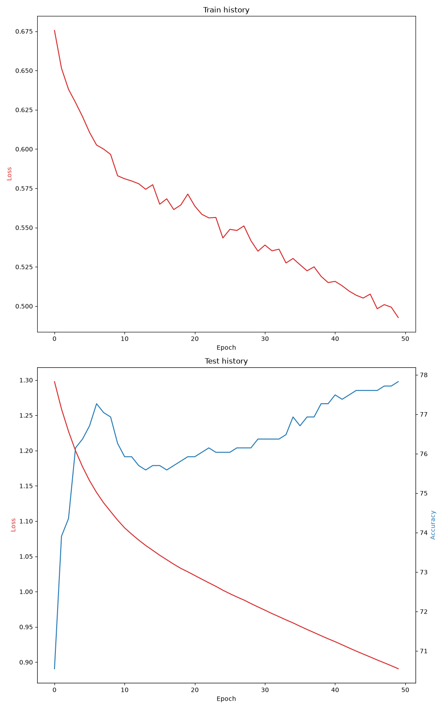

# Student depression prognosis

[Dataset source](https://www.kaggle.com/datasets/mkhoirulmustaqim/student-depression-detection-dataset)

This prognosis based on following parametrs:
- Gender
- Age
- Economic status of family
- Romantic relationship status
- Marital status
- Living arrangement (alone or with peers)
- Semester the student is currently enrolled in
- Academic performance
- Respondents friend circle (yes/no)
- Health condition
- Home region

## Classical ML model

